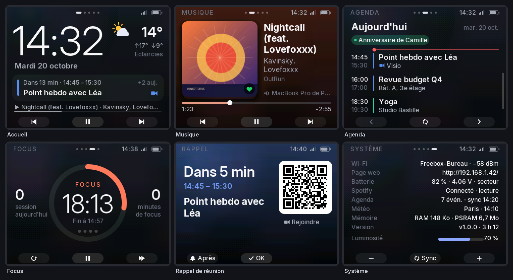

# Desk Station — M5Stack Core2

Une station de bureau pour le M5Stack Core2 qui affiche ce qui compte au bon moment : l'heure,
la météo, le prochain rendez-vous, et une télécommande Spotify. Elle sait aussi rappeler une
réunion et lancer un minuteur de concentration.



*Captures générées sur PC avec le code de l'interface (`tools/preview`) et des données de démo.*

## Fonctions

| Écran | Ce qu'il montre | Boutons A · B · C |
|---|---|---|
| **Accueil** | Heure, date, météo du jour, prochain rendez-vous (« dans 13 min », visio), morceau en cours, alerte pluie | ⏮ · ⏯ · ⏭ |
| **Musique** | Pochette, titre/artiste/album, appareil Spotify, barre de progression. Le fond prend la couleur dominante de la pochette | ⏮ · ⏯ · ⏭ |
| **Agenda** | Journée par journée sur 7 jours, avec les calendriers iCloud lus directement et leurs couleurs : événements sur la journée, horaires, lieux, visio, ligne « maintenant » | jour − · aujourd'hui / synchro · jour + |
| **Focus** | Pomodoro 25/5 avec grande pause après 4 sessions, sessions et minutes du jour | reset · ▶/❚❚ · passer |
| **Système** | Wi-Fi, adresse de la page web, batterie, état Spotify/agenda/météo, mémoire | luminosité − · synchro · luminosité + |
| **Rappel** | 5 min avant une réunion : écran plein, vibration, son, LED, QR code du lien visio | plus tard · OK |

Ce que la station fait seule, pour que vous ayez moins à vérifier :

- **Retour automatique** à l'écran le plus utile après 45 s sans interaction : Focus si un minuteur
  tourne, Musique si quelque chose joue, sinon Accueil.
- **Rappel de réunion** N minutes avant chaque événement. Le QR code permet de rejoindre la visio
  (Meet, Zoom, Teams, Webex, FaceTime…) depuis le téléphone.
- **Alerte pluie** sur l'Accueil quand une averse est probable dans les 12 prochaines heures.
- **Écran atténué** après 2 min, **mode nuit** (22 h – 7 h) avec extinction après 1 min.
- **Heure conservée** dans l'horloge RTC : l'heure s'affiche dès le démarrage, sans attendre le Wi-Fi.
- **Focus + musique** (option) : la musique reprend quand une session démarre et se met en pause
  pendant les pauses.

### Gestes

- **Glisser à gauche / droite** : changer d'écran. Les points en haut indiquent la page, et un
  toucher sur ces points passe à l'écran suivant.
- **Musique** : toucher la pochette pour ajouter le morceau aux *Titres likés* (ou appui long sur B),
  glisser vers le haut ou le bas pour régler le volume, toucher la barre pour avancer dans le morceau.
  ⏮ revient au début du morceau s'il a dépassé 5 s, comme sur un lecteur. Si rien ne joue,
  ▶ relance la lecture sur votre appareil préféré.
- **Agenda** : glisser verticalement pour faire défiler.
- **Écran éteint** : le premier toucher rallume l'écran sans déclencher d'action.

## Installation

### 1. Outils

- [VS Code](https://code.visualstudio.com/) avec l'extension **PlatformIO IDE**, ou en ligne de commande :
  `pip install platformio`
- Un câble USB-C. Sur macOS, le pilote CH9102 est inclus dans les versions récentes ; sinon,
  installez-le depuis le site de M5Stack.

### 2. Configuration

```bash
cp include/config.example.h include/config.h
```

Ouvrez `include/config.h` (ignoré par git) et renseignez au minimum :

- le **Wi-Fi** (`kWifi`, en 2,4 GHz uniquement) ;
- le **fuseau horaire** (Paris est la valeur par défaut) ;
- les **coordonnées** pour la météo (`kLatitude`, `kLongitude`, `kPlaceName`).

### 3. Spotify (facultatif)

Le contrôle de la lecture par l'API Spotify demande un compte **Premium**. Depuis février 2026, le
propriétaire d'une application en mode développement doit lui aussi être Premium, et une application
est limitée à 5 utilisateurs. Pour un usage personnel, aucun de ces points ne pose problème.

1. Ouvrez <https://developer.spotify.com/dashboard> et cliquez sur **Create app**.
2. Dans **Redirect URIs**, ajoutez exactement `http://127.0.0.1:8888/callback`. Spotify refuse
   `localhost`.
3. Cochez **Web API**, puis enregistrez.
4. Copiez le **Client ID** et le **Client Secret** dans `kSpotifyClientId` et `kSpotifyClientSecret`.
5. Obtenez l'autorisation par l'une de ces deux méthodes :
   - **Depuis la station** (sans rien installer) : flashez le firmware, ouvrez l'écran Musique puis
     scannez le QR code (ou ouvrez `http://deskstation.local/`). Cliquez sur *Autoriser Spotify*.
     Le navigateur atterrit ensuite sur une page d'erreur `127.0.0.1`, ce qui est normal : copiez
     l'adresse de cette page et collez-la dans le formulaire. Le jeton est conservé dans la mémoire
     de la station.
   - **Depuis l'ordinateur** : lancez `python3 tools/spotify_auth.py --write`. Le script ouvre le
     navigateur, récupère le jeton et l'écrit dans `include/config.h`.
6. Facultatif : indiquez dans `kSpotifyPreferredDevice` un morceau du nom de l'appareil sur lequel
   relancer la musique quand rien n'est actif, par exemple `"MacBook"`.

### 4. Calendrier Apple (et autres)

**Méthode recommandée : iCloud en direct (CalDAV).** La station lit vos calendriers iCloud avec un
*mot de passe pour app*, sans rien rendre public. Elle reprend aussi les noms et les couleurs de
l'app Calendrier.

1. Ouvrez <https://account.apple.com>, puis *Connexion et sécurité* › **Mots de passe pour app**
   (l'identification à deux facteurs doit être activée). Créez un mot de passe nommé « Desk Station ».
2. Dans `include/config.h` :

   ```cpp
   constexpr const char* kCalDavUser = "prenom.nom@icloud.com";  // e-mail du compte Apple
   constexpr const char* kCalDavPassword = "abcd-efgh-ijkl-mnop";
   constexpr const char* kCalDavCalendars = "";  // ex. "Maison, Travail" ; vide = tous
   ```

Au démarrage, la station découvre vos calendriers d'événements. Elle ignore les listes Rappels
et les boîtes de réception. Toutes les 10 minutes, elle demande ensuite à iCloud les événements des
8 prochains jours. Les répétitions, exceptions et occurrences déplacées sont calculées sur la station.
La liste des calendriers est rafraîchie toutes les 6 heures.

> Le mot de passe pour app est stocké en clair dans le firmware. Il donne accès aux protocoles
> iCloud (calendrier, contacts, mail), mais pas à la gestion du compte. Vous pouvez le révoquer à
> tout moment depuis la même page.

La même configuration fonctionne avec d'autres serveurs CalDAV ; changez seulement `kCalDavUrl` :
Fastmail (`https://caldav.fastmail.com/`), Nextcloud (`https://votre-cloud/remote.php/dav/`)…

**Autres calendriers : liens iCal** (`.ics` / `webcal://`), qu'on peut combiner avec iCloud :

- **Google Agenda** : Paramètres › votre agenda › *Adresse secrète au format iCal*.
- **Outlook / Microsoft 365** : Paramètres › Calendrier › Calendriers partagés › *Publier un
  calendrier* › lien ICS.
- **Calendrier iCloud public** (si vous ne voulez pas de mot de passe pour app) : dans l'app
  Calendrier sur Mac, clic droit sur le calendrier › *Partager le calendrier…* › **Calendrier
  public**. Le lien est lisible par quiconque le possède.

```cpp
constexpr CalendarSource kCalendars[] = {
    {"Google", "https://calendar.google.com/calendar/ical/…/basic.ics", 0xF59E0B},
};
```

8 calendriers au total (iCloud + liens iCal).

### 5. Flasher

```bash
pio run -t upload          # compile et flashe en USB
pio device monitor         # journaux série (115200 bauds)
```

**Mises à jour par Wi-Fi.** Renseignez `kOtaPassword`, flashez une première fois en USB, puis :

```bash
DESK_OTA_PASSWORD=motdepasse pio run -e core2-ota -t upload
```

## Architecture

```
          cœur 1 (loop Arduino)                         cœur 0 (tâches FreeRTOS)
 ┌──────────────────────────────────┐       ┌──────────────────────────────────────┐
 │ entrées (tactile + 3 boutons)     │       │ net     Wi-Fi, NTP, page web, OTA    │
 │ Shell : navigation, rappels,      │◄──────│ spotify jeton, état de lecture, file │
 │   retour auto, luminosité         │ Store │         de commandes, pochettes      │
 │ rendu dans un sprite PSRAM →      │──────►│ feeds   iCal (parseur en streaming), │
 │   écran (transitions glissées)    │ cmds  │         + CalDAV iCloud, météo       │
 └──────────────────────────────────┘       └──────────────────────────────────────┘
```

- `src/core/`: code portable sans Arduino, testé sur PC. On y trouve l'arithmétique des dates, les
  fuseaux POSIX et le **parseur iCal**, qui gère le streaming, les règles RRULE (DAILY, WEEKLY,
  MONTHLY et YEARLY avec INTERVAL, COUNT, UNTIL, BYDAY, BYMONTHDAY, BYMONTH, BYSETPOS et WKST),
  les EXDATE, les occurrences modifiées (RECURRENCE-ID) et les fuseaux TZID. On y trouve aussi le
  **client CalDAV** : découverte du compte, requêtes `calendar-query` limitées à la fenêtre
  affichée, et extraction en streaming du contenu `calendar-data` (CDATA ou texte échappé).
- `src/ui/`: l'interface. Elle dessine dans un sprite M5GFX : polices **Inter** anti-aliasées
  (accents compris), icônes vectorielles (SDF), dégradés tramés et un écran par fichier dans
  `apps/`.
- `src/services/`: Wi-Fi, Spotify, iCal, météo et page web. Toutes les connexions HTTPS sont
  vérifiées avec les autorités racines de Mozilla (`data/cert/x509_crt_bundle.bin`).
- Toutes les commandes Spotify sont **optimistes** : l'écran réagit tout de suite, puis Spotify
  confirme au sondage suivant (1 s quand l'écran Musique est affiché).

## Tests et aperçus

```bash
make -C test/host                                         # tests unitaires (dates, fuseaux, iCal, CalDAV)
pip install recurring-ical-events && make -C test/host ics_dump
python3 test/host/diff_test.py 300                        # comparaison avec une implémentation de référence
pip install radicale && make -C test/host caldav_live
python3 test/host/caldav_e2e.py                           # CalDAV de bout en bout contre un serveur Radicale local

# Captures d'écran sur PC (g++ + libsdl2-dev ; M5GFX est récupéré par PlatformIO)
pio pkg install -e core2
make -C tools/preview shots                               # -> docs/screenshots/
```

La CI GitHub (`.github/workflows/firmware.yml`) lance les tests et compile le firmware à chaque push.

Pour régénérer les polices : `tools/gen_fonts.sh` (nécessite Pillow et fontTools).

## Limites connues

- **Spotify.** Pas de navigation dans la bibliothèque, seulement le contrôle de la lecture en cours.
  Les changements faits ailleurs apparaissent en 1 à 8 s selon l'écran affiché.
- **Calendriers.** Les règles infra-journalières (HOURLY…) ne sont pas développées. Les fuseaux
  TZID inconnus de la table intégrée (`src/core/tz.cpp`) sont interprétés dans le fuseau local.
  Les calendriers sont en lecture seule.
- **Wi-Fi.** 2,4 GHz uniquement (limite de l'ESP32).
- **Titres non latins.** Les titres en japonais, en coréen, etc. ne s'affichent pas : la police
  embarquée couvre le latin étendu.

## Pistes d'évolution

- Statut « ne pas déranger » (Slack/macOS) pendant les sessions Focus.
- Écran domotique (Home Assistant).

---

Police : [Inter](https://rsms.me/inter/) © The Inter Project Authors, sous licence SIL Open
Font License 1.1 (`src/ui/fonts/LICENSE-Inter.txt`).
